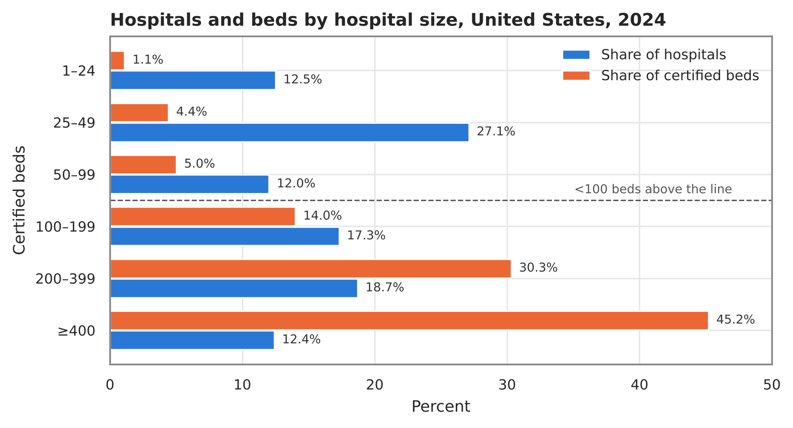
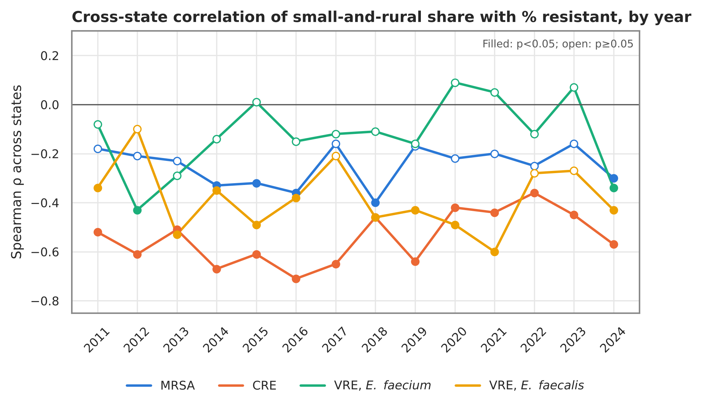
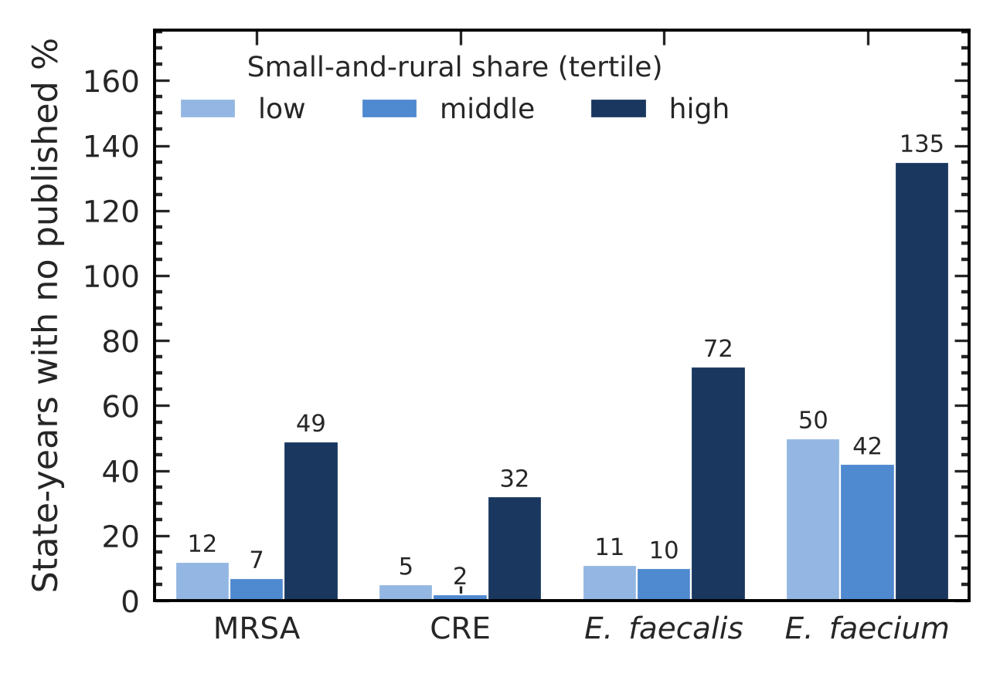
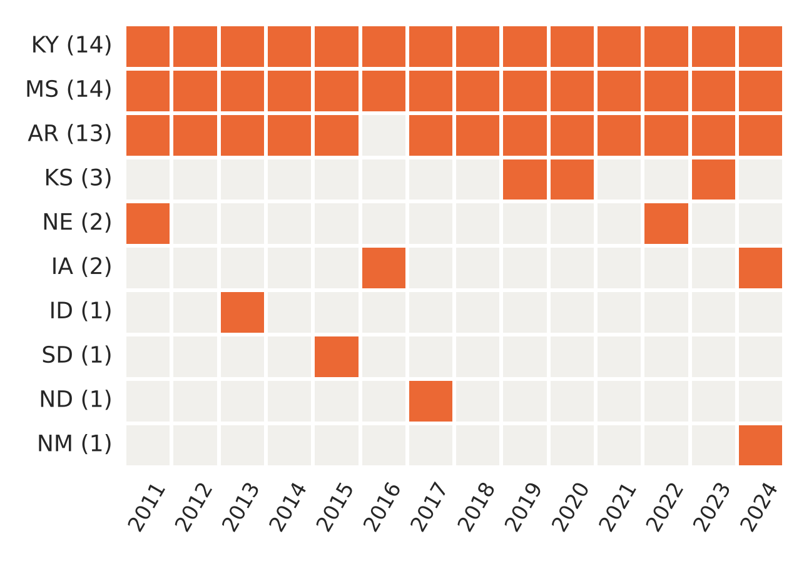
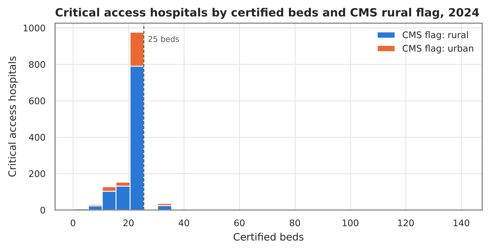

**Correspondence:** Fatima Abdulwahab, abdulwahabfatima43@gmail.com

**Article type:** Data resource and descriptive analysis (preprint)

**Running title:** Resistance and small and rural hospitals by state

**Keywords:** antimicrobial resistance; MRSA; carbapenem-resistant Enterobacterales; vancomycin-resistant enterococci; National Healthcare Safety Network; critical access hospitals; rural health; Provider of Services file; open data

```{=openxml}
<w:p><w:r><w:br w:type="page"/></w:r></w:p>
```

# Abstract

**Background.** Small and rural hospitals deliver a large share of U.S. inpatient care in many states, often with limited on-site microbiology, infectious disease expertise and rapid diagnostics. State resistance surveillance and federal hospital registries are published separately, so it has not been easy to see where resistance and a small-hospital network coincide.

**Methods.** We built an open state-by-year table for the 50 states, the District of Columbia and Puerto Rico, 2011–2024 (728 state-years). It joins Centers for Disease Control and Prevention (CDC) Antimicrobial Resistance & Patient Safety Portal percent resistance for methicillin-resistant *Staphylococcus aureus* (MRSA), carbapenem-resistant Enterobacterales (CRE) and vancomycin-resistant *Enterococcus faecalis* and *E. faecium* (VRE), from infections reported to the National Healthcare Safety Network, to counts of active short-term acute care and critical access hospitals by certified bed size and rural location from the December Centers for Medicare & Medicaid Services (CMS) Provider of Services file. We documented every rule, reproduced CDC's published confidence intervals, and described cross-state associations with Spearman correlation.

**Results.** In 2024, 4,500 general hospitals were counted (3,132 short-term, 1,368 critical access). Hospitals with fewer than 100 beds made up 51.6% of hospitals but held 10.6% of beds; 33.5% were both small and rural. State resistance varied widely (MRSA state median 37.0%; IQR 31.6–42.7%). Across states, a larger small-and-rural share went with lower, not higher, percent resistant for all four organisms (CRE ρ = -0.57, p < 0.001, n = 51; MRSA ρ = -0.30, p = 0.032, n = 50). Within that gradient, Kentucky and Mississippi were in the top third of states for both MRSA resistance and small-and-rural share in all 14 years, and Arkansas in 13. States in the top third for small-and-rural share accounted for 288 of 427 state-years in which CDC published no percent (fewer than 20 isolates). We also found two data pitfalls: older portal tables store suppressed cells as "0 of 0", and 19.4% of critical access hospitals carry the CMS urban flag.

**Conclusions.** Resistance among reported hospital infections is, on average, lower in states dominated by small and rural hospitals, but a persistent Southern group of states combines high MRSA resistance with a large small-and-rural hospital network, and resistance data are thinnest where small hospitals are most common. The atlas, code and an interactive map are openly available to guide where laboratory, stewardship and diagnostic support for small hospitals may reach the most facilities.

```{=openxml}
<w:p><w:r><w:br w:type="page"/></w:r></w:p>
```

# Introduction

Antimicrobial resistance remains one of the most consequential threats to U.S. patients. CDC's threat assessments rank carbapenem-resistant Enterobacterales as an urgent threat and MRSA and vancomycin-resistant enterococci as serious threats [1]. Much of the national picture of resistance in hospital infections comes from the National Healthcare Safety Network (NHSN), to which nearly all U.S. acute care hospitals report central line-associated bloodstream infections (CLABSI), catheter-associated urinary tract infections (CAUTI) and surgical site infections (SSI), including the pathogens and their susceptibility results [2,3]. CDC publishes these as pooled percent resistant by state and year on the Antimicrobial Resistance & Patient Safety Portal [4].

The U.S. hospital network is highly unequal in size: many hospitals are small, including more than 1,300 rural critical access hospitals [5], while most beds are in a minority of large hospitals. Small hospitals face distinct challenges in detecting and managing resistant organisms: fewer infectious disease physicians and pharmacists, smaller or outsourced microbiology laboratories, and less access to rapid molecular and phenotypic testing [6,7]. A resistant organism that a large academic laboratory identifies within hours may reach a small hospital as a referral result days later. Where resistance is common and much of the hospital care is delivered by small hospitals, those gaps matter most.

Yet the two pieces of information needed to see where this happens are published separately. CDC's portal reports resistance by state but not by hospital size at state level. The CMS Provider of Services (POS) file lists every Medicare-certified hospital with its type, bed count and location, but carries no resistance data [8]. To our knowledge, no open, reproducible table joins them across states and years.

This paper describes such a resource, the State Atlas of Hospital Resistance and Small Hospitals, and uses it to answer three descriptive questions. First, how is the U.S. general hospital network distributed by size and rural location, state by state, from 2011 to 2024? Second, is state-level resistance among reported hospital infections higher or lower where small and rural hospitals make up more of the network, and which states combine high resistance with a large small-and-rural network? Third, where are the gaps in the resistance data themselves? We also document two data pitfalls that affect anyone using these sources.

# Methods

## Design and unit of analysis

This is a descriptive, ecological study of public, aggregated data. The unit of analysis is the state-year: the 50 states, the District of Columbia and Puerto Rico (the places CDC reports at state level), for each calendar year from 2011 to 2024, giving 728 rows. No patient-level or facility-level resistance data were used, and no human subjects research approval was required.

## Resistance data

We extracted state-by-year tables from the CDC Antimicrobial Resistance & Patient Safety Portal (AR HAI dataset) profile pages for four phenotypes: methicillin-resistant *S. aureus* (MRSA), carbapenem-resistant Enterobacterales (CRE), vancomycin-resistant *E. faecalis* and vancomycin-resistant *E. faecium* [4]. Each page embeds, in its page data, the complete table behind its state map: state, year, infection type, percent resistant, number resistant, number tested, 95% confidence interval and a suppression flag. We used the row combining all three infection types (CLABSI, CAUTI and SSI). Phenotype definitions follow CDC [4]. CDC computes a pooled mean percent resistant as the sum of resistant isolates divided by the sum of isolates tested, does not publish a percent when fewer than 20 isolates were tested, and reports mid-P exact 95% confidence intervals [9,10]. CDC's methods note cautions that the data should not be used for definitive conclusions about change over time or about a state compared with the nation, because surveillance definitions, laboratory breakpoints and state reporting requirements differ [9].

Two handling rules were applied. First, the portal stores most cells with fewer than 20 isolates as "0 resistant, 0 tested, 0%" in 2011–2022 (and one such cell in each of 2023 and 2024), and as blanks otherwise. All such cells were recorded as insufficient data with no value; a reported 0% (for example, 0 of 44 isolates) was kept. Second, the portal includes a "New England" Census-division row in 2011–2022 and a "No Geography Data" row in some years. These 240 rows were dropped; each New England state also has its own row, and the division total equals the sum of its states.

We also derived a pooled vancomycin-resistant enterococci value (*E. faecalis* plus *E. faecium* counts) with a mid-P 95% interval, only where both species had published counts. CDC's national table by facility type (general acute care hospitals, long-term acute care hospitals, inpatient rehabilitation facilities) was retained for context.

## Hospital data

For each year we used the December release of the CMS POS file (Hospital & Non-Hospital Facilities), discovered from the data.cms.gov catalog [8]. We kept active providers (termination code 00) in the hospital category with subtype 01 (short-term acute care) or 11 (critical access), located in the 52 places. Bed size is certified beds (CRTFD_BED_CNT). "Rural" is the CMS urban-rural indicator (CBSA_URBN_RRL_IND = R, outside a metropolitan core-based statistical area). "Small" is fewer than 100 certified beds. "Small and rural" requires both. Children's, psychiatric, rehabilitation and long-term care hospitals, and rural emergency hospitals (which have no inpatient beds), were not counted.

Short-term hospitals listing two or fewer certified beds were excluded. During 2020–2022 the POS file listed several hundred additional active short-term hospitals with one or two beds; by name, most were ambulatory surgery centers and freestanding emergency departments, consistent with temporary COVID-19 public health emergency flexibilities that let such facilities enroll as hospitals. The rule removed 225, 273 and 240 such entries in 2020, 2021 and 2022 (up to 145 in Texas in 2021), and between 1 and 5 genuine very small hospitals in other years. Every excluded row is listed in the released hospital file.

Because the CMS rural flag classified some critical access hospitals as urban (see Results), we added an alternative measure, "small and rural, or critical access", that counts every critical access hospital regardless of flag or bed count.

## Measures

For each state-year we computed: counts of general hospitals, short-term and critical access hospitals; counts in six certified-bed bands (1–24, 25–49, 50–99, 100–199, 200–399, ≥400); counts and percentages of hospitals that were small, rural, small and rural, and small-and-rural-or-critical-access; total certified beds and the percentage of beds in small and in rural hospitals. Resistance measures were percent resistant, counts, confidence interval and status for each phenotype.

## Analysis

All analyses are descriptive. We summarised the national hospital network by year and by bed band, and resistance in 2024 by organism (state median and interquartile range, extremes, and the sum of published state counts). Cross-state association between small-and-rural share and percent resistant was described with Spearman rank correlation, separately for each organism and year, using only states with a published percent. We repeated it with the alternative critical-access measure, with the percentage of small hospitals, and with the percentage of beds in small hospitals, and for CRE excluding Puerto Rico. No adjustment for multiple comparisons was made, and p-values are reported as descriptive. To identify states where high resistance and a large small-and-rural network coincide, we flagged states in the top third (at or above the 66.7th percentile among states, within year) on both measures and counted how many years each state was flagged. Finally, we compared how often resistance was unavailable across within-year tertiles of small-and-rural share.

## Reproducibility, quality assurance and verification

A five-script pipeline (fetch, build, quality checks, map, documentation) reproduces all tables. Every downloaded file is logged with its date, size and SHA-256 fingerprint. An automated quality report checks row counts, join completeness, internal consistency of counts, percentages and intervals, and that no suppressed cell is shown as zero; it reports 0 failed checks. Our mid-P implementation reproduced CDC's published intervals exactly in 300 randomly sampled cells. The author independently verified the release: all raw fingerprints matched; a fresh download and rebuild produced byte-identical outputs; separately written code reproduced all 11,888 CDC rows, every hospital count and bed total in all 728 state-years, and 200 of 200 sampled CDC intervals; and named values were checked by hand. All numbers in this paper are generated from the pipeline's statistics file. Analyses used Python 3 (pandas, SciPy); figures used Matplotlib and Seaborn.

# Results

## The atlas

The released table has 728 rows (52 places × 14 years) and 61 columns; all state-years matched between sources. Published state counts accounted for 99.5% (MRSA), 99.8% (CRE), 99.1% (*E. faecalis*) and 96.7% (*E. faecium*) of isolates in CDC's national facility-type tables over 2011–2024; the remainder came from territories, events without a state, and suppressed cells. As a check, the sum of published states for MRSA in 2024 was 38.2% (3,650 of 9,557), matching CDC's national figure of 38.2% (3,659 of 9,579) [4].

## The hospital network

In 2024 the atlas counted 4,500 active general hospitals: 3,132 short-term acute care and 1,368 critical access hospitals (Figure 3). Between 2011 and 2024 the number of short-term hospitals fell by 11.7% (from 3,546), while critical access hospitals rose slightly (from 1,330); the total fell by 7.7%.

Size was highly skewed (Figure 2, Table 1). Hospitals with fewer than 100 beds were 51.6% of hospitals (2,322) but held 10.6% of the 800,576 certified beds. Hospitals with 400 or more beds were 12.4% of hospitals and held 45.2% of beds. The 25–49-bed band, which contains most critical access hospitals, was the largest single group (27.1% of hospitals, 4.4% of beds). Changing the cutoff for "small" changed the share substantially: 39.6% of hospitals had fewer than 50 beds and 68.9% fewer than 200 (CDC's own national size split), holding 5.5% and 24.6% of beds.

Nationally, 39.8% of general hospitals were rural and 33.5% (1,507) were both small and rural. State profiles differed sharply (Figure 1A). Most hospitals were small in 31 of 52 places, and most were small and rural in 13. The state median small-and-rural share was 35.2% (IQR 15.6–50.2), from 0% in District of Columbia, Delaware, New Jersey, Puerto Rico and Rhode Island to 84.1% in North Dakota.

**Critical access hospitals and the rural flag.** Of 1,368 critical access hospitals in 2024, 266 (19.4%) carried the CMS urban flag, and 68 listed more than 25 certified beds (maximum 138), likely because swing beds or distinct-part psychiatric or rehabilitation units are included (Supplementary Figure S1). The flag-based small-and-rural measure therefore omits about one in five critical access hospitals; counting all of them raised the national small-and-rural-or-critical-access share to 39.4%.

## Resistance by state

Table 2 summarises resistance in 2024. MRSA was reported for 50 places, with a state median of 37.0% (IQR 31.6–42.7), ranging from North Dakota 14.3% (4/28) to West Virginia 64.4% (38/59). MRSA resistance was highest across a band of Southern and Appalachian states (Figure 1B). CRE was reported for 51 places (median 2.3% (IQR 1.5–3.8)); Puerto Rico was a marked outlier at 43.2% (118 of 273), more than four times the next-highest state. Vancomycin resistance was 59.9% (IQR 55.0–65.6) among *E. faecium* (reported for only 36 places) and 2.9% (IQR 0.0–4.7) among *E. faecalis*. The derived pooled enterococcal value could be computed for 36 places (sum 24.0%).

For context, CDC's national figures by facility type in 2024 showed much higher resistance in long-term acute care hospitals than in general acute care hospitals: MRSA 70.1% vs 37.7%, CRE 8.7% vs 3.1%, *E. faecium* 79.5% vs 58.9%.

Summed across published states, percent resistant in 2024 was lower than in 2011 for all four organisms (MRSA 46.7% to 38.2%; CRE 4.3% to 3.3%; *E. faecium* 80.6% to 60.1%). Consistent with CDC's guidance, we report these without inference about trend, because definitions and reporting changed over the period [9].

## Resistance and the small-and-rural hospital share

Across states, a larger share of small and rural hospitals was associated with lower percent resistant for all four organisms in 2024 (Figure 4, Table 3): CRE ρ = -0.57, p < 0.001, n = 51; *E. faecalis* ρ = -0.43, p = 0.002, n = 49; *E. faecium* ρ = -0.34, p = 0.045, n = 36; MRSA ρ = -0.30, p = 0.032, n = 50. The CRE association was not driven by Puerto Rico (excluding it, ρ = -0.54, p < 0.001, n = 50). Results were similar with the alternative measure counting all critical access hospitals, and with the share of small hospitals; associations with the share of beds in small hospitals were similar for CRE and *E. faecalis* and weaker for MRSA and *E. faecium* (Table 3).

The direction was stable over time (Figure 5). For CRE, ρ ranged from -0.71 to -0.36 and was negative with p < 0.05 in all 14 years. For *E. faecalis*, ρ was negative in all 14 years (-0.60 to -0.10; p < 0.05 in 10). For MRSA, ρ was negative in all 14 years but modest (-0.40 to -0.16; p < 0.05 in 5). For *E. faecium*, estimates were inconsistent (-0.43 to 0.09; negative in 10 of 14 years, p < 0.05 in 2), reflecting the many states without published values.

## States where high resistance and a small-and-rural network coincide

Despite the overall inverse gradient, some states combined both features (Table 4). In 2024, 5 states were in the top third for both MRSA resistance (≥39.2%) and small-and-rural share (≥46.2%): Arkansas, Iowa, Kentucky, Mississippi and New Mexico. Together they had 215 small and rural hospitals. This pattern was persistent (Figure 7): Kentucky and Mississippi were flagged in all 14 years and Arkansas in 13; no other state was flagged in more than 3 years. For the other organisms, the overlap in 2024 comprised Maine and North Dakota for CRE, Kentucky and Maine for *E. faecalis*, and Arkansas for *E. faecium*; several of these rest on small isolate counts (for example Maine, *E. faecalis* 22.2%, 6 of 27).

## Where the resistance data are missing

Across all years and organisms, CDC published no percent for 427 state-years. States in the top tertile of small-and-rural share accounted for 288 of these, compared with 61 in the middle and 78 in the bottom tertile (Figure 6). The concentration held for every organism: MRSA 49 of 68, CRE 32 of 39, *E. faecalis* 72 of 93 and *E. faecium* 135 of 227. In 2024, MRSA was unavailable for Alaska and Wyoming, both among the states with the highest small-and-rural shares, and *E. faecium* was unavailable for 16 places.

# Discussion

## Principal findings

This open atlas places state resistance among reported hospital infections next to the size and rural composition of each state's general hospital network, for 14 years. Three findings stand out. First, small hospitals are the majority of U.S. general hospitals but hold about one in ten beds, and in about a quarter of states most hospitals are both small and rural. Second, contrary to a simple expectation that resistance burden is heaviest where small hospitals predominate, states with more small and rural hospitals had, on average, lower percent resistance, most clearly for CRE and *E. faecalis* and modestly for MRSA. Third, this average hides two groups that matter for small hospitals: a persistent Southern cluster (Kentucky, Mississippi and Arkansas) where high MRSA resistance and a large small-and-rural network coincide year after year, and the most rural states, where the resistance data are most often missing altogether.

## Interpretation

The inverse gradient is plausible. CRE and vancomycin-resistant enterococci are concentrated in populations with intensive healthcare exposure: long-term acute care hospitals, large referral centers, transplant and oncology services, and dense networks of patient transfer, which are features of metropolitan areas [3,11]. CDC's own national tables show resistance in long-term acute care hospitals several times that of general acute care hospitals. States dominated by small rural hospitals have fewer such settings. The weaker gradient for MRSA, which is common in both healthcare and community settings, fits this explanation, as does the regional Southern pattern of high MRSA that crosses urban and rural states.

The finding is ecological. It describes states, not hospitals, and cannot show that resistance is lower in small hospitals [12]. CDC does not publish state resistance by hospital size, and the HAI events behind each state percentage are likely to come mostly from larger hospitals, which perform more procedures and place more central lines and catheters. A state's percent therefore largely reflects its larger hospitals. What a small rural hospital in that state encounters, particularly in patients transferred to or from larger centers, may differ.

## Implications

For state health departments, laboratory networks and hospital associations, the atlas suggests two kinds of priority rather than one. Where high resistance and a large small-hospital network coincide, as with MRSA in Kentucky, Mississippi and Arkansas, small hospitals likely encounter resistant organisms often enough to justify investment in local laboratory capacity, rapid testing access, stewardship support and clear referral pathways [6,7]. Where resistance data are missing, the gap is itself a finding. The states with the highest small-and-rural shares are also those where CDC most often cannot publish a percent, because too few isolates are reported. Small hospitals there have the least state-level evidence to calibrate empiric therapy, and pooling across years, regional antibiograms or expanded reporting may be needed.

The atlas also documents two pitfalls for anyone using these sources. Treating the portal's "0 of 0" cells as 0% would produce false reports of zero resistance concentrated in exactly the small, rural states this analysis concerns. And the CMS rural flag misclassifies about one in five critical access hospitals as urban, so analyses of "rural hospitals" built on that flag alone omit a substantial part of the critical access program.

## Strengths and limitations

Strengths include complete coverage of all places CDC reports at state level for 14 years, use of counts and intervals rather than published percentages alone, explicit and documented handling of suppressed cells, temporary pandemic-era enrollments and the critical access flag, exact reproduction of CDC's interval method, and independent verification of every table. All data, code and an interactive map are openly available.

Limitations are substantial. Resistance reflects isolates from three types of reported infection, not all clinical cultures or community infections. The analysis is ecological and cross-sectional within each year; correlations are unadjusted, describe states rather than hospitals, and should not be read causally. CDC cautions against interpreting change over time and state-versus-nation comparisons, and laboratory breakpoints, reporting mandates and validation differ by state and year [9]. Suppression removes data non-randomly, from the smallest and most rural states. "Small" and "rural" depend on definitions; we used fewer than 100 certified beds and the CMS flag, provided bed bands and an alternative critical-access measure, and showed that the share of small hospitals is sensitive to the cutoff. Certified beds may differ from staffed beds, and the December snapshot misses mid-year openings and closures. Long-term acute care, rehabilitation and children's hospitals contribute to CDC's state figures but were not counted on the hospital side. Finally, the CDC tables are read from data embedded in public web pages rather than a formal download service; the pipeline stops if their structure changes.

## Future work

Planned extensions include annual updates as CDC releases new years; an alternative rural definition from the Federal Office of Rural Health Policy; county-level maps of the hospital network; linking each hospital to its CLIA laboratory certificate to describe how many small hospitals perform microbiology on site; and additional phenotypes, including carbapenem-resistant *Acinetobacter* and *Pseudomonas aeruginosa*.

# Conclusions

Small hospitals make up half of U.S. general hospitals. Across states, resistance among reported hospital infections is on average lower where small and rural hospitals dominate. But a persistent group of Southern states combines high MRSA resistance with a large small-and-rural network, and resistance data are scarcest in the most rural states. An open, reproducible atlas makes these patterns visible and can help direct laboratory, diagnostic and stewardship support to the places where small hospitals face resistant organisms with the least local capacity and the least data.

# Declarations

**Data and code availability.** The dataset, code, quality report, codebook, limitations and verification record are openly available at https://github.com/FatimaAbdulwahab/state-resistance-small-hospital-atlas (version 1.0.0; Zenodo DOI pending (minted on archiving the v1.0.0 GitHub release; linked from the repository)). The interactive map is at https://fatimaabdulwahab.github.io/state-resistance-small-hospital-atlas/. Data and documentation are licensed CC BY 4.0 and code MIT. Source data are U.S. federal government works from CDC and CMS.

**Ethics.** This study used only publicly available, aggregated data and involved no human subjects.

**Funding.** None.

**Competing interests.** The author declares no competing interests.

**Author contributions (CRediT).** Fatima Abdulwahab: conceptualization, methodology, data curation, validation, formal analysis, visualization, writing (original draft, review and editing).

**Use of AI tools.** Claude (Anthropic) assisted with code, data processing, figure generation and drafting. The author designed the study, made all analytic decisions, independently verified every table and number against the sources, and takes full responsibility for the content.

```{=openxml}
<w:p><w:r><w:br w:type="page"/></w:r></w:p>
```

# References

1. Centers for Disease Control and Prevention. Antibiotic Resistance Threats in the United States, 2019. Atlanta, GA: U.S. Department of Health and Human Services, CDC; 2019.
2. Centers for Disease Control and Prevention. National Healthcare Safety Network (NHSN). https://www.cdc.gov/nhsn/index.html
3. Weiner-Wells LM, et al. Antimicrobial-resistant pathogens associated with adult healthcare-associated infections: summary of data reported to the National Healthcare Safety Network, 2015–2017. Infect Control Hosp Epidemiol. 2020;41(1):1–18.
4. Centers for Disease Control and Prevention. Antimicrobial Resistance & Patient Safety Portal: antimicrobial resistance profiles (MRSA; carbapenem-resistant Enterobacterales; vancomycin-resistant *Enterococcus faecalis* and *E. faecium*). https://arpsp.cdc.gov/psp/listing/antimicrobial-resistance. Accessed 6 November 2026.
5. Flex Monitoring Team. The Flex Program. https://www.flexmonitoring.org/the-flex-program
6. Stenehjem E, Hyun DY, Septimus E, et al. Antibiotic stewardship in small hospitals: barriers and potential solutions. Clin Infect Dis. 2017;65(4):691–696.
7. Centers for Disease Control and Prevention. Core Elements of Hospital Antibiotic Stewardship Programs. Atlanta, GA: U.S. Department of Health and Human Services, CDC; 2019.
8. Centers for Medicare & Medicaid Services. Provider of Services File – Hospital & Non-Hospital Facilities (December releases 2011–2024). https://data.cms.gov/provider-characteristics/hospitals-and-other-facilities/provider-of-services-file-hospital-non-hospital-facilities. Accessed 6 November 2026.
9. Centers for Disease Control and Prevention. Antimicrobial Resistance & Patient Safety Portal. Methodology: Antimicrobial Resistance HAI Data. January 2026.
10. Berry G, Armitage P. Mid-P confidence intervals: a brief review. J R Stat Soc Ser D (The Statistician). 1995;44(4):417–423.
11. Guh AY, Bulens SN, Mu Y, et al. Epidemiology of carbapenem-resistant Enterobacteriaceae in 7 US communities, 2012–2013. JAMA. 2015;314(14):1479–1487.
12. Robinson WS. Ecological correlations and the behavior of individuals. Am Sociol Rev. 1950;15(3):351–357.

```{=openxml}
<w:p><w:r><w:br w:type="page"/></w:r></w:p>
```

# Tables

**Table 1.** U.S. general hospitals and certified beds by hospital size, 2024.

| Certified beds | Hospitals | % of hospitals | Certified beds | % of beds |
|:--|--:|--:|--:|--:|
| 1–24 | 563 | 12.5 | 9,145 | 1.1 |
| 25–49 | 1,221 | 27.1 | 35,085 | 4.4 |
| 50–99 | 538 | 12.0 | 40,306 | 5.0 |
| 100–199 | 779 | 17.3 | 112,296 | 14.0 |
| 200–399 | 842 | 18.7 | 242,196 | 30.3 |
| ≥400 | 557 | 12.4 | 361,548 | 45.2 |
| **Total** | **4,500** | **100.0** | **800,576** | **100.0** |

Active short-term acute care (CMS subtype 01) and critical access (subtype 11) hospitals in the December 2024 Provider of Services file, 50 states, DC and Puerto Rico; short-term hospitals with ≤2 certified beds excluded.

```{=openxml}
<w:p><w:r><w:br w:type="page"/></w:r></w:p>
```

**Table 2.** Percent resistant by state, 2024.

| Organism | Reported / no value | State median (IQR), % | Highest, % (R/N) | Lowest, % (R/N) | All published states, % (R/N) |
|:---------|:-------|:---------|:----------|:----------|:------------|
| MRSA | 50 / 2 | 37.0 (31.6–42.7) | WV 64.4 (38/59) | ND 14.3 (4/28) | 38.2 (3,650/9,557) |
| CRE | 51 / 1 | 2.3 (1.5–3.8) | PR 43.2 (118/273) | 0.0 (several states) | 3.3 (773/23,663) |
| VRE, *E. faecalis* | 49 / 3 | 2.9 (0.0–4.7) | ME 22.2 (6/27) | 0.0 (several states) | 3.6 (272/7,514) |
| VRE, *E. faecium* | 36 / 16 | 59.9 (55.0–65.6) | AR 78.0 (46/59) | CO 27.8 (10/36) | 60.1 (2,405/4,003) |

Source: CDC AR & Patient Safety Portal, all infection types (CLABSI, CAUTI, SSI). Reported / no value: places with a published percent / places with fewer than 20 isolates tested (of 52). R/N: resistant/tested. States by postal abbreviation.


**Table 3.** Spearman correlation across states between hospital-network measures and percent resistant, 2024.

| Organism | Small and rural, % | Small and rural or critical access, % | Small (<100 beds), % | Beds in small hospitals, % |
|:--|:--|:--|:--|:--|
| MRSA (n = 50) | -0.30 (0.032) | -0.30 (0.036) | -0.30 (0.031) | -0.26 (0.071) |
| CRE (n = 51) | -0.57 (<0.001) | -0.55 (<0.001) | -0.58 (<0.001) | -0.59 (<0.001) |
| VRE, *E. faecalis* (n = 49) | -0.43 (0.002) | -0.45 (0.001) | -0.46 (0.001) | -0.44 (0.002) |
| VRE, *E. faecium* (n = 36) | -0.34 (0.045) | -0.36 (0.030) | -0.34 (0.045) | -0.24 (0.157) |

Values are ρ (p). States without a published percent excluded. Descriptive, unadjusted, ecological; not corrected for multiple comparisons.

```{=openxml}
<w:p><w:r><w:br w:type="page"/></w:r></w:p>
```

**Table 4.** States in the top third of states for both percent resistant and small-and-rural hospital share, 2024.

| Organism | State | % resistant | Small and rural, % | General hospitals | Small and rural | Critical access |
|:--|:--|--:|--:|--:|--:|--:|
| MRSA | Arkansas | 55.3 | 46.5 | 71 | 33 | 27 |
| MRSA | Iowa | 39.3 | 66.4 | 113 | 75 | 83 |
| MRSA | Kentucky | 45.2 | 48.3 | 89 | 43 | 30 |
| MRSA | Mississippi | 58.2 | 47.1 | 87 | 41 | 29 |
| MRSA | New Mexico | 40.7 | 59.0 | 39 | 23 | 13 |
| CRE | Maine | 9.2 | 59.4 | 32 | 19 | 18 |
| CRE | North Dakota | 3.1 | 84.1 | 44 | 37 | 37 |
| VRE, *E. faecalis* | Kentucky | 5.1 | 48.3 | 89 | 43 | 30 |
| VRE, *E. faecalis* | Maine | 22.2 | 59.4 | 32 | 19 | 18 |
| VRE, *E. faecium* | Arkansas | 78.0 | 46.5 | 71 | 33 | 27 |

Top third: at or above the 66.7th percentile among states with a published value (resistance) or among all 52 places (small-and-rural share). MRSA, years flagged 2011–2024: Kentucky 14; Mississippi 14; Arkansas 13; Kansas 3; Nebraska 2; Iowa 2; Idaho 1; South Dakota 1; North Dakota 1; New Mexico 1.

```{=openxml}
<w:p><w:r><w:br w:type="page"/></w:r></w:p>
```

# Figures

{width=100%}

{width=80%}

{width=80%}

{width=100%}

{width=80%}

{width=80%}

{width=80%}

```{=openxml}
<w:p><w:r><w:br w:type="page"/></w:r></w:p>
```

# Supplementary material

{width=80%}

**Supplementary Table S1.** State profiles for 2024 (all 52 places) are provided as `paper/tables/table_state_profile_last_year.csv` in the repository; the full state-by-year table is `data/processed/atlas_state_year.csv`, documented in `docs/CODEBOOK.md`.
